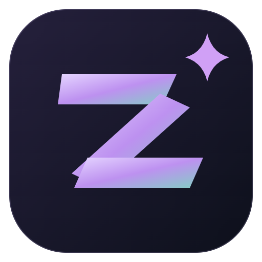
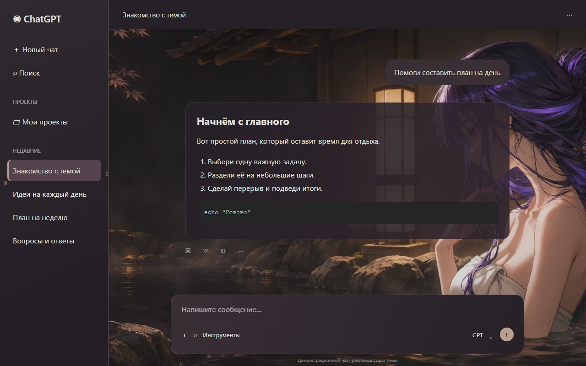
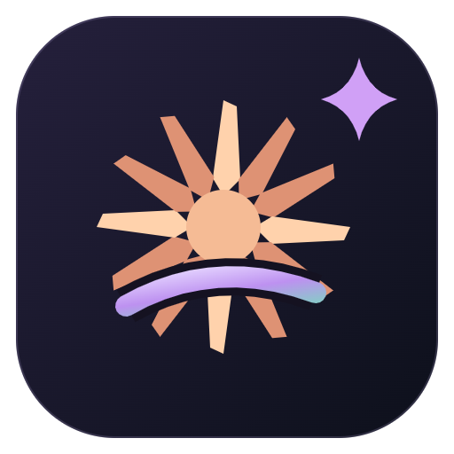
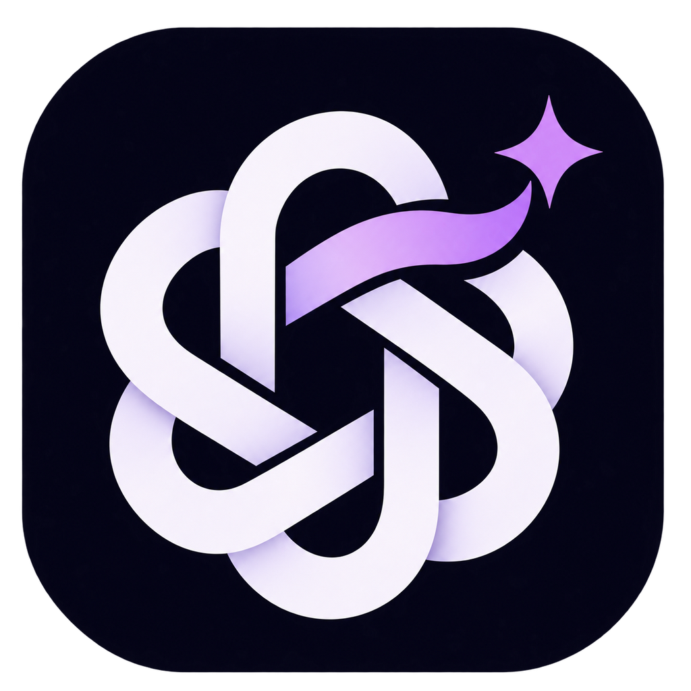
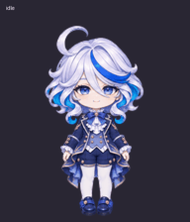
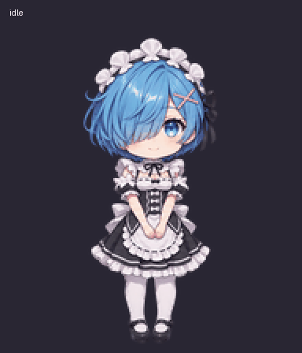
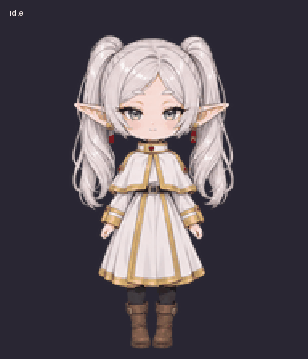
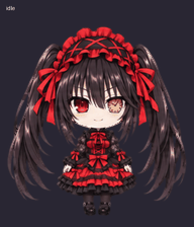

<div align="center">
  
  <h1>ZLHRS Theme Studio</h1>
  <p>99 themes for ChatGPT and Claude Desktop.<br>One Studio. Two apps. Your own atmosphere.<br>23 animated companions for ChatGPT Pets.</p>
  <p><a href="https://github.com/ZLHRS/codex-anime-themes/releases/latest"><b>Download the app</b></a> · <a href="docs/GALLERY.md">Explore the themes</a> · <a href="#installation">Installation</a></p>
</div>



## Download

**Version 2.7.0 supports ChatGPT and Claude Desktop in one Studio**, with 99 themes, 12 Live ASCII scenes, original-quality compositions, separate shortcuts and new project icons. [Release notes](docs/RELEASE-2.7.0.md).

| Your system | Ready-to-use download |
| --- | --- |
| Windows 10/11 · x64 | [Portable ZIP](https://github.com/ZLHRS/codex-anime-themes/releases/download/v2.7.0/ZLHRS-Theme-Studio-2.7.0-win-x64-portable.zip) · [Installer](https://github.com/ZLHRS/codex-anime-themes/releases/download/v2.7.0/ZLHRS-Theme-Studio-2.7.0-win-x64.exe) |
| Mac · Apple Silicon (M-series) | [Apple Silicon ZIP](https://github.com/ZLHRS/codex-anime-themes/releases/download/v2.6.6/ZLHRS-Theme-Studio-2.6.6-mac-arm64.zip) |
| Mac · Intel | [Intel ZIP](https://github.com/ZLHRS/codex-anime-themes/releases/download/v2.6.6/ZLHRS-Theme-Studio-2.6.6-mac-x64.zip) |
| Linux · x64 | [AppImage](https://github.com/ZLHRS/codex-anime-themes/releases/download/v2.6.6/ZLHRS-Theme-Studio-2.6.6-linux-x86_64.AppImage) · [Debian/Ubuntu DEB](https://github.com/ZLHRS/codex-anime-themes/releases/download/v2.6.6/ZLHRS-Theme-Studio-2.6.6-linux-amd64.deb) |

Mac and Linux links above are older 2.6.6 builds; 2.7.0 is the Windows release.

[All 2.7.0 files and checksums →](https://github.com/ZLHRS/codex-anime-themes/releases/tag/v2.7.0) · [Standalone Claude data-only archive](https://github.com/ZLHRS/codex-anime-themes/releases/download/v2.7.0/ZLHRS-Claude-Themes-2.7.0.zip)

The standalone Claude archive uses compressed pictures and static video posters. For original artwork, authored layouts and live theme controls, use the unified Studio.

> A compatible ChatGPT or Claude desktop app must be installed separately. Studio changes its appearance; it does not replace either app. Theme application has been verified on Windows. Mac and Linux builds and galleries have been checked, but connection to the actual ChatGPT app has not yet been confirmed.

## Installation

### Windows

1. Download the Windows ZIP and **extract the entire archive** into a permanent folder.
2. Open **ZLHRS Theme Studio.exe** from that folder.
3. Keep the EXE and its companion files together.

If SmartScreen appears, use **More info → Run anyway**, when available, only for a trusted download from this repository. The build is currently unsigned.

### macOS

1. Check **Apple menu → About This Mac**. Choose Apple Silicon for an M-series chip, or Intel for an Intel processor.
2. Extract the matching ZIP and move **ZLHRS Theme Studio.app** to **Applications**.
3. Try opening the app. If macOS blocks it because the developer cannot be verified, open **System Settings → Privacy & Security**, find the message about Theme Studio, and click **Open Anyway**. Confirm and authenticate if prompted.
4. Open Studio again.

The build is not yet signed or notarized by Apple. Only allow an app you downloaded from this repository and trust. The Open Anyway option appears after an attempted launch. If macOS specifically reports malware or a damaged file, do not bypass that warning; download again and verify the source. [Apple’s opening instructions](https://support.apple.com/102445).

### Linux

- **AppImage:** allow the file to run as a program in its properties, then open it. Keep it in a permanent folder.
- **DEB:** open the package in your software manager and install it. Your system may ask for a password.

If AppImage cannot start because FUSE is unavailable, use the DEB on Debian or Ubuntu.

## Choose your theme

1. Open Studio and click **ChatGPT** or **Claude** on a theme card. Each app remembers its own theme.
2. If an app is not found, locate it in **Settings**. Claude requires the mod setup below.
3. Create **ZLHRS Theme Studio**, **Claude Theme**, or **ChatGPT Theme** in Settings. Each button creates only its own shortcut.
4. Launch an app through its themed shortcut to restore its saved theme.

On Mac and Linux, fully close ChatGPT before applying a theme for the first time. On Windows, Studio restarts it if needed, so save any unsent text first.

**Make it yours:** Settings lets you adjust image brightness, size, and position for each theme. Decorative effects and animations can be turned off.

**Choose a language:** open **Settings → Interface language** and select **English** or **Russian**. The interface changes immediately and remembers your choice. Theme selection and artwork settings stay intact.

## Claude support

**Русский:** Studio поддерживает ChatGPT и Claude Desktop: отдельные кнопки на карточках, независимый выбор темы и настройки изображения, три отдельных ярлыка. Для Claude один раз установите **Claude Desktop Themes** через `/themes → Install extension` и перезапустите приложение. Затем выбирайте темы кнопкой **Claude** прямо в Studio.

1. Install the community **Claude Desktop Themes** mod and its extension using [the Claude setup guide](docs/CLAUDE-CODE.md).
2. Fully restart Claude after the initial extension setup.
3. Select a theme with the **Claude** button in Studio. Later changes apply live.

The updated Studio preserves original image quality, rotation, full backgrounds and paired compositions. The left navigation follows the theme palette; the right panel does not shift the artwork. Brightness, scale, placement and supported animations are saved independently for each app. Windows Claude Desktop has been tested; this is a community integration, not an official Anthropic feature.

**Pets remain a ChatGPT feature in Studio.** ChatGPT pet imports do not install companions into Claude.

## Project identity and shortcuts

| Shortcut | Icon | Opens |
| --- | --- | --- |
| ZLHRS Theme Studio |  | Theme gallery and settings |
| Claude Theme |  | Claude with its saved theme |
| ChatGPT Theme |  | ChatGPT with its saved theme |

The ZLHRS mark is a ribbon-shaped Z in lilac and mint. Claude Theme pairs a warm star with the same lilac accent. The existing ChatGPT Theme icon is preserved. These are project launcher icons, not official product branding.

## Custom pets

**23 animated chibi companions for ChatGPT Pets.** Detailed outfits, expressions, and movement—from gentle and cozy to bold and elegant. Meet six members of the collection:

<table>
<tr>
<td align="center" width="33%"><br><b>Furina</b><br><sub>Theatrical and playful</sub></td>
<td align="center" width="33%"><br><b>Rem</b><br><sub>Gentle and caring</sub></td>
<td align="center" width="33%"><br><b>Frieren</b><br><sub>Calm and cozy</sub></td>
</tr>
<tr>
<td align="center" width="33%"><br><b>Kurumi</b><br><sub>Gothic and mysterious</sub></td>
<td align="center" width="33%"><br><b>C.C.</b><br><sub>Bold and unflappable</sub></td>
<td align="center" width="33%"><br><b>Fubuki</b><br><sub>Elegant and confident</sub></td>
</tr>
</table>

**To add them:** click **Add through ChatGPT** in Studio, paste the copied prompt into a chat with the Pets plugin available, and send it. Then select your favorite pet manually.

Pets is a separate ChatGPT feature. Studio does not upload pets directly to your account, and changing themes does not switch your active pet. The import prompt requires Pets to be available in your ChatGPT.

## Updates

Use **Check for updates** in Studio. It checks the latest release, downloads the update, and restarts while preserving your selected theme. Git is not required.

If the update fails, download a fresh build from the table above. Extract the entire Windows ZIP into a new folder. On Mac, replace the app in Applications; you may need to allow it to open again.

> **Code → Download ZIP contains source code.** For everyday use, download the packaged app from the Download section.

## What changed in 2.6.8

- Added 12 original MIT-licensed ASCII scenes by 0toshigami, with motion, speed, cell-size and chat-backdrop settings.
- Pauses ASCII drawing in inactive windows and respects reduced motion.
- See [Live ASCII wallpapers](docs/ASCII-WALLPAPERS.md) for attribution and settings.

## What changed in 2.6.7

- Expanded the gallery to 85 themes, with updated full-screen artwork and matching interface palettes.
- Refreshed portraits, landscape compositions and previews, including the latest Crimson Stained Glass orientation and color adjustments.
- Added animated theme media support and per-pet hover behavior; no new pets were created.
- Verified English and Russian switching, saved language preference, translated gallery text and search.
- Updated the English documentation, gallery and portable start guide.

[Explore all 99 themes](docs/GALLERY.md) · [Changelog](CHANGELOG.md)

<details>
<summary><b>Having trouble launching or applying a theme?</b></summary>

- Make sure you downloaded a build for your system, not the source archive.
- On Windows, extract the whole folder, not just the EXE.
- On Mac, allow Studio to open using the instructions above.
- Locate ChatGPT manually and use the themed shortcut instead of the old icon.
- A ChatGPT update may require a newer Studio version.
- Still stuck? [Open an issue](https://github.com/ZLHRS/codex-anime-themes/issues) with the error message, operating system, and Studio version.

[Compatibility and setup details](docs/CROSS-PLATFORM.md).

</details>

<details>
<summary><b>For developers</b></summary>

Requires Node.js 24+.

```sh
git clone https://github.com/ZLHRS/codex-anime-themes.git
cd codex-anime-themes
npm ci
npm start
```

Run checks with `npm test`, `npm run test:integration`, and `npm run test:i18n-ui`. Build with `npm run dist`. On headless Linux, run UI checks through `xvfb-run -a`. Packaged builds are published in Releases, not committed to the source tree.

</details>
