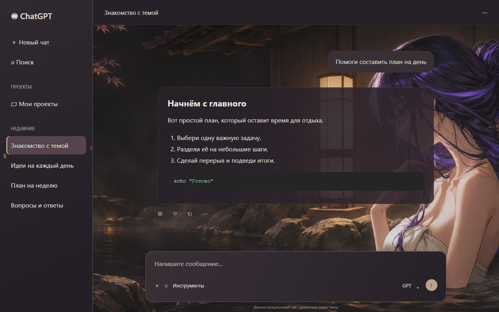

<div align="center">
  
  <h1>ZLHRS Theme Studio</h1>
  <p>60 тем для настольного ChatGPT.<br>Выберите оформление — Studio запомнит его.</p>
  <p><a href="https://github.com/ZLHRS/codex-anime-themes/releases/latest"><b>Скачать приложение</b></a> · <a href="docs/GALLERY.md">Посмотреть темы</a> · <a href="#установка">Установка</a></p>
</div>



## Скачать

**Версия 2.6.5 · все 60 тем уже внутри.** Git и Node.js для запуска не нужны.

| Ваша система | Готовая сборка |
| --- | --- |
| Windows 10/11 · x64 | [ZIP — без установки](https://github.com/ZLHRS/codex-anime-themes/releases/download/v2.6.5/ZLHRS-Theme-Studio-2.6.5-win-x64-portable.zip) |
| Mac · Apple Silicon (чип M-серии) | [ZIP для Apple Silicon](https://github.com/ZLHRS/codex-anime-themes/releases/download/v2.6.5/ZLHRS-Theme-Studio-2.6.5-mac-arm64.zip) |
| Mac · Intel | [ZIP для Intel](https://github.com/ZLHRS/codex-anime-themes/releases/download/v2.6.5/ZLHRS-Theme-Studio-2.6.5-mac-x64.zip) |
| Linux · x64 | [AppImage](https://github.com/ZLHRS/codex-anime-themes/releases/download/v2.6.5/ZLHRS-Theme-Studio-2.6.5-linux-x86_64.AppImage) · [DEB для Debian/Ubuntu](https://github.com/ZLHRS/codex-anime-themes/releases/download/v2.6.5/ZLHRS-Theme-Studio-2.6.5-linux-amd64.deb) |

[Все файлы выпуска, установщики и контрольные суммы →](https://github.com/ZLHRS/codex-anime-themes/releases/tag/v2.6.5)

> **Нужен отдельно установленный совместимый настольный ChatGPT.** Studio меняет его оформление и не заменяет само приложение. В браузере темы не работают. Применение проверено на Windows; для Mac и Linux проверены сборки и галерея, но подключение к реальному ChatGPT пока не подтверждено.

## Установка

### Windows

1. Скачайте Windows ZIP и **распакуйте его целиком** в постоянную папку.
2. Откройте **ZLHRS Theme Studio.exe** из этой папки.
3. Не переносите EXE отдельно — остальные файлы рядом нужны для работы.

Если Windows показывает окно SmartScreen, для проверенного файла из этого репозитория откройте **«Подробнее» → «Выполнить в любом случае»**, если такая кнопка доступна. Сборка пока без цифровой подписи.

### macOS

1. Посмотрите тип процессора: ** → «Об этом Mac»**. Для чипа M-серии нужен Apple Silicon, для процессора Intel — Intel.
2. Распакуйте подходящий ZIP и перенесите **ZLHRS Theme Studio.app** в **«Программы»**.
3. Попробуйте открыть приложение. Если macOS не разрешает запуск из-за непроверенного разработчика:
   - откройте ** → «Системные настройки» → «Конфиденциальность и безопасность»**;
   - найдите сообщение о блокировке **ZLHRS Theme Studio** и нажмите **«Всё равно открыть»**;
   - подтвердите открытие и введите пароль или используйте Touch ID, если система попросит.
4. Снова запустите Studio.

Сборка пока без подписи и нотариализации Apple. Разрешайте запуск только для файла, который скачали из этого репозитория и которому доверяете. Кнопка разрешения появляется после попытки запуска. Если macOS сообщает именно о вредоносном ПО или повреждении файла, не обходите это предупреждение — скачайте файл заново и проверьте источник. [Официальная инструкция Apple](https://support.apple.com/ru-ru/102445).

### Linux

- **AppImage:** в свойствах файла разрешите выполнение как программы, затем откройте файл. Храните его в постоянной папке.
- **DEB:** откройте пакет через менеджер приложений и установите. Система может попросить пароль.

Если AppImage не запускается из-за FUSE, используйте DEB на Debian/Ubuntu.

## Включить тему

1. Откройте Studio и выберите тему в галерее.
2. Если ChatGPT не найден, нажмите **«Выбрать приложение»** и укажите установленный ChatGPT.
3. Примените тему и создайте ярлык кнопкой **«Создать ярлык ChatGPT»**.
4. Дальше запускайте **«ChatGPT с темой»** через этот ярлык — оформление восстановится автоматически.

На Mac и Linux перед первым применением полностью закройте ChatGPT. На Windows Studio при необходимости перезапустит его сама: заранее сохраните неотправленный текст.

**Подстройте под себя:** размер, яркость и положение картинки доступны в разделе «Настроить выбранную тему». Настройки запоминаются отдельно для каждой темы. Декоративные эффекты и анимации можно выключить.

## Обновить

Нажмите **«Подтянуть изменения»** в Studio. Программа проверит готовый выпуск, скачает обновление и перезапустится. Выбранная тема сохраняется. Git устанавливать не нужно.

Если обновление не установилось, скачайте свежую сборку из таблицы выше. Windows ZIP распаковывайте в новую папку целиком. На Mac замените приложение в «Программах»; разрешение запуска иногда нужно подтвердить снова.

> **Code → Download ZIP — это исходники.** Для обычного использования скачивайте готовое приложение из раздела «Скачать».

## Что нового в 2.6.5

- Смягчены резкие стыки изображений с фоном в темах, где были заметны обрезанные края.
- Обновлены портреты Фурины, Резе и других персонажей; исправлен чёрный предпросмотр Вагури.
- Персонажи больше не приглушаются общей прозрачностью. Плавные переходы используются только на нужных краях.
- Сохранены нейтральные блоки кода без фиолетовой обводки.

[Все 60 тем с картинками](docs/GALLERY.md) · [История изменений](CHANGELOG.md)

<details>
<summary><b>Питомцы персонажей</b></summary>

В Studio доступен готовый набор из 23 питомцев. Кнопка **«Добавить питомцев через ChatGPT»** копирует запрос для чата с доступным плагином Pets. Studio сама не загружает их в аккаунт. Выбор питомца ручной; переключение темы его не меняет. В этом выпуске новые питомцы не добавлялись.

</details>

<details>
<summary><b>Не получается запустить или применить тему?</b></summary>

- Убедитесь, что скачали сборку для своей системы, а не архив исходников.
- В Windows распакуйте всю папку, а не только EXE.
- На Mac разрешите открытие Studio по инструкции выше.
- Укажите ChatGPT вручную и используйте ярлык **«ChatGPT с темой»**, а не старый значок.
- После обновления ChatGPT может понадобиться новая версия Studio.
- Если проблема остаётся, [создайте обращение](https://github.com/ZLHRS/codex-anime-themes/issues) и приложите текст ошибки, систему и версию Studio.

[Подробности совместимости и настройки](docs/CROSS-PLATFORM.md).

</details>

<details>
<summary><b>Для разработчиков</b></summary>

Нужен Node.js 24+.

```sh
git clone https://github.com/ZLHRS/codex-anime-themes.git
cd codex-anime-themes
npm ci
npm start
```

Проверки: `npm test` и `npm run test:integration`. Сборка: `npm run dist`. В Linux без дисплея запускайте проверки через `xvfb-run -a`. Готовые сборки публикуются в Releases, а не в дереве исходников.

</details>
