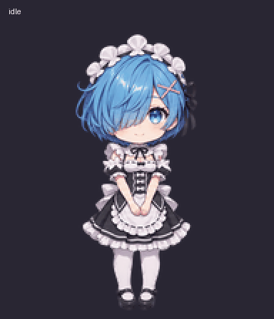
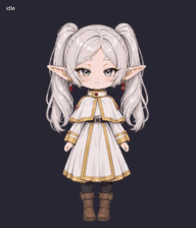

<div align="center">
  
  <h1>ZLHRS Theme Studio</h1>
  <p>61 themes for desktop ChatGPT.<br>Choose your atmosphere. Studio remembers it.<br>Bring along one of 23 custom animated companions.</p>
  <p><a href="https://github.com/ZLHRS/codex-anime-themes/releases/latest"><b>Download the app</b></a> · <a href="docs/GALLERY.md">Explore the themes</a> · <a href="#installation">Installation</a></p>
</div>


## Download

**Version 2.6.5 includes 60 themes.** No Git or Node.js required.

| Your system | Ready-to-use download |
| --- | --- |
| Windows 10/11 · x64 | [Portable ZIP](https://github.com/ZLHRS/codex-anime-themes/releases/download/v2.6.5/ZLHRS-Theme-Studio-2.6.5-win-x64-portable.zip) |
| Mac · Apple Silicon (M-series) | [Apple Silicon ZIP](https://github.com/ZLHRS/codex-anime-themes/releases/download/v2.6.5/ZLHRS-Theme-Studio-2.6.5-mac-arm64.zip) |
| Mac · Intel | [Intel ZIP](https://github.com/ZLHRS/codex-anime-themes/releases/download/v2.6.5/ZLHRS-Theme-Studio-2.6.5-mac-x64.zip) |
| Linux · x64 | [AppImage](https://github.com/ZLHRS/codex-anime-themes/releases/download/v2.6.5/ZLHRS-Theme-Studio-2.6.5-linux-x86_64.AppImage) · [Debian/Ubuntu DEB](https://github.com/ZLHRS/codex-anime-themes/releases/download/v2.6.5/ZLHRS-Theme-Studio-2.6.5-linux-amd64.deb) |

[All release files, installers, and checksums →](https://github.com/ZLHRS/codex-anime-themes/releases/tag/v2.6.5)

> A compatible desktop ChatGPT app must be installed separately. Studio changes its appearance; it does not replace ChatGPT or work in the browser. Theme application has been verified on Windows. Mac and Linux builds and galleries have been checked, but connection to the actual ChatGPT app has not yet been confirmed.

**Latest source updates:** the 61st theme, Jade Silhouette, and an English/Russian interface switch are available in the source code. They are not included in the 2.6.5 downloads above yet.

## Installation

### Windows

1. Download the Windows ZIP and **extract the entire archive** into a permanent folder.
2. Open **ZLHRS Theme Studio.exe** from that folder.
3. Keep the EXE and its companion files together.

If SmartScreen appears, use **More info → Run anyway**, when available, only for a trusted download from this repository. The build is currently unsigned.

### macOS

1. Check **Apple menu → About This Mac**. Choose Apple Silicon for an M-series chip, or Intel for an Intel processor.
2. Extract the matching ZIP and move **ZLHRS Theme Studio.app** to **Applications**.
3. Try opening the app. If macOS blocks it because the developer cannot be verified, open **System Settings → Privacy & Security**, find the message about Theme Studio, and click **Open Anyway**. Confirm and authenticate if prompted.
4. Open Studio again.

The build is not yet signed or notarized by Apple. Only allow an app you downloaded from this repository and trust. The Open Anyway option appears after an attempted launch. If macOS specifically reports malware or a damaged file, do not bypass that warning; download again and verify the source. [Apple’s opening instructions](https://support.apple.com/102445).

### Linux

- **AppImage:** allow the file to run as a program in its properties, then open it. Keep it in a permanent folder.
- **DEB:** open the package in your software manager and install it. Your system may ask for a password.

If AppImage cannot start because FUSE is unavailable, use the DEB on Debian or Ubuntu.

## Choose your theme

1. Open Studio and choose a theme in the gallery.
2. If ChatGPT is not found, use **Choose application** to locate the installed app.
3. Apply the theme, then use **Create / update shortcuts** in Settings.
4. Launch ChatGPT through the themed shortcut from now on. Your last theme will return automatically.

On Mac and Linux, fully close ChatGPT before applying a theme for the first time. On Windows, Studio restarts it if needed, so save any unsent text first.

**Make it yours:** Settings lets you adjust image brightness, size, and position for each theme. Decorative effects and animations can be turned off.

**Choose a language:** in the latest source version, open **Settings → Interface language** and select **English** or **Russian**. The interface changes immediately and remembers your choice. Theme selection and artwork settings stay intact. The 2.6.5 release still uses the Russian interface; the button names above describe their English equivalents.

## Custom pets

**23 animated chibi companions for ChatGPT Pets.** Detailed outfits, expressions, and movement—from gentle and cozy to bold and elegant. Meet six members of the collection:

<table>
<tr>
<td align="center" width="33%"><br><b>Furina</b><br><sub>Theatrical and playful</sub></td>
<td align="center" width="33%"><br><b>Rem</b><br><sub>Gentle and caring</sub></td>
<td align="center" width="33%"><br><b>Frieren</b><br><sub>Calm and cozy</sub></td>
</tr>
<tr>
<td align="center" width="33%"><br><b>Kurumi</b><br><sub>Gothic and mysterious</sub></td>
<td align="center" width="33%"><br><b>C.C.</b><br><sub>Bold and unflappable</sub></td>
<td align="center" width="33%"><br><b>Fubuki</b><br><sub>Elegant and confident</sub></td>
</tr>
</table>

**To add them:** click **Add through ChatGPT** in Studio, paste the copied prompt into a chat with the Pets plugin available, and send it. Then select your favorite pet manually.

Pets is a separate ChatGPT feature. Studio does not upload pets directly to your account, and changing themes does not switch your active pet. The import prompt requires Pets to be available in your ChatGPT.

## Updates

Use **Check for updates** in Studio. It checks the latest release, downloads the update, and restarts while preserving your selected theme. Git is not required.

If the update fails, download a fresh build from the table above. Extract the entire Windows ZIP into a new folder. On Mac, replace the app in Applications; you may need to allow it to open again.

> **Code → Download ZIP contains source code.** For everyday use, download the packaged app from the Download section.

## What changed in 2.6.5

- Softer transitions where artwork had visibly cropped edges.
- Updated Furina, Reze, and other portraits; fixed Waguri’s black preview.
- Portraits are no longer dimmed by global transparency. Blending is limited to edges where needed.
- Neutral code blocks without purple outlines.

[Explore all 61 themes](docs/GALLERY.md) · [Changelog](CHANGELOG.md)

<details>
<summary><b>Having trouble launching or applying a theme?</b></summary>

- Make sure you downloaded a build for your system, not the source archive.
- On Windows, extract the whole folder, not just the EXE.
- On Mac, allow Studio to open using the instructions above.
- Locate ChatGPT manually and use the themed shortcut instead of the old icon.
- A ChatGPT update may require a newer Studio version.
- Still stuck? [Open an issue](https://github.com/ZLHRS/codex-anime-themes/issues) with the error message, operating system, and Studio version.

[Compatibility and setup details](docs/CROSS-PLATFORM.md) (Russian).

</details>

<details>
<summary><b>For developers</b></summary>

Requires Node.js 24+.

```sh
git clone https://github.com/ZLHRS/codex-anime-themes.git
cd codex-anime-themes
npm ci
npm start
```

Run checks with `npm test`, `npm run test:integration`, and `npm run test:i18n-ui`. Build with `npm run dist`. On headless Linux, run UI checks through `xvfb-run -a`. Packaged builds are published in Releases, not committed to the source tree.

</details>
