# Codex Anime Themes · ZLHRS

Коллекция из 16 тем для настольного Codex / ChatGPT на Windows: отдельная папка на каждую тему, иллюстрации, палитры и инструкция по установке.

**[Как установить →](docs/INSTALL-RU.md)** · **[Скачать набор ZIP](codex-anime-themes.zip)**

## Запуск в два клика — v1.1.0

Скачайте ZIP, распакуйте и откройте **START.cmd**. Выберите тему в окне с превью и нажмите **«Применить / открыть»**.

**Всё для выбора и применения тем уже внутри. Node.js и Codex App Manager не требуются.** Нужно только установленное приложение Codex / ChatGPT для Windows.

## Каталог

Превью ниже — иллюстрации и палитры, не снимки интерфейса. Реальное расположение задаёт CSS каждой темы.

| [Ай Хосино · Bunny Refrain](themes/ai-bunny-refrain) | [Ай Хосино · Starlit Encore](themes/ai-starlit-encore) |
| --- | --- |
| 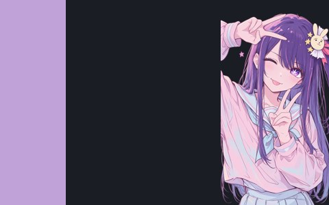 | 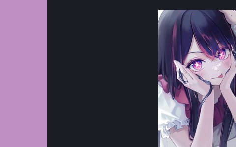 |

| [Azure Morpho](themes/azure-morpho) | [Фурина · Blue Cat Nocturne](themes/blue-cat-nocturne) |
| --- | --- |
| 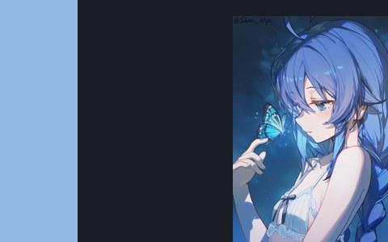 | 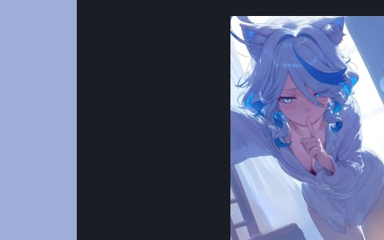 |

| [C.C. · Mint Contract](themes/cc-mint-contract) | [Фубуки · Velvet Reflection](themes/fubuki-velvet) |
| --- | --- |
| 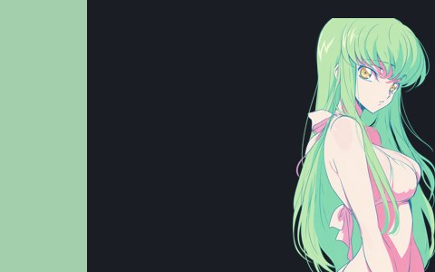 | 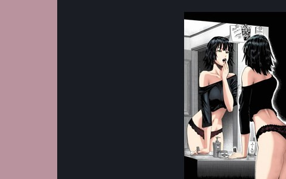 |

| [Фурина · Голубой свет](themes/furina-blue-daylight) | [Фурина · Moonlit Repose](themes/furina-moonlit-repose) |
| --- | --- |
| 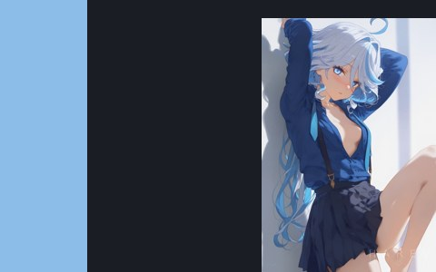 | 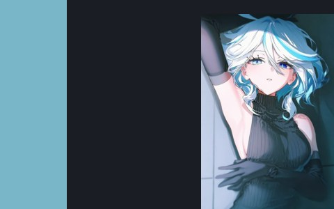 |

| [Ху Тао × Фурина · Красный и синий](themes/hu-tao-furina-duality) | [Резе · Night Bloom](themes/reze-night-bloom) |
| --- | --- |
| 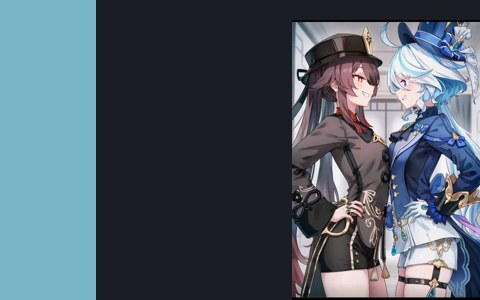 | 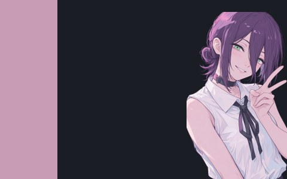 |

| [Шинобу Кочо · Wisteria Veil](themes/shinobu-wisteria) | [Sora · Silver Ribbon](themes/sora-ribbon) |
| --- | --- |
| 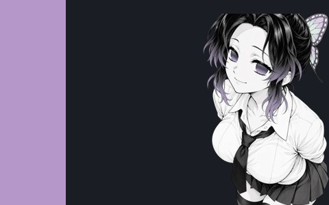 | 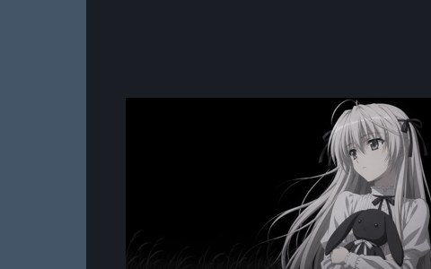 |

| [Сильфи · Moonstone Atelier](themes/sylphie-moonstone) | [Татсумаки · Jade Orbit](themes/tatsumaki-jade) |
| --- | --- |
| 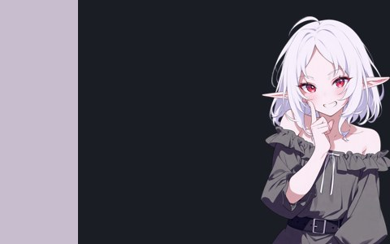 | 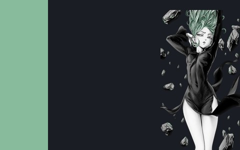 |

| [Тацумаки · Jade Duo](themes/tatsumaki-jade-duo) | [Zero Two · Darling Rose](themes/zero-two-rose) |
| --- | --- |
| 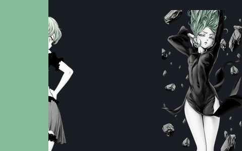 |  |

## Структура

- `themes/<id>/` — готовая тема: настройки, стили и используемые изображения.
- `previews/` — компактные превью для выбора.
- `docs/INSTALL-RU.md` — установка, переключение и устранение проблем.
- `Install-Themes.ps1` — копирование тем в пользовательскую папку, без выбора активной темы.
- `START.cmd` и `Theme-Selector.ps1` — встроенное окно выбора тем.
- `launcher/Theme-Engine.ps1` — автономный механизм применения без Node.js.
- Остальные файлы `launcher/` — совместимость со старым способом запуска.
- `catalog.json` — список всех тем.

## Совместимость и права

Это неофициальные пользовательские темы, зависящие от структуры интерфейса приложения. После обновления приложения может потребоваться адаптация CSS. Код запуска использует MIT-компоненты Wangnov; исходная лицензия сохранена в `launcher/LICENSE`. Иллюстрации и персонажи принадлежат их правообладателям, MIT-лицензия запуска не распространяется на изображения. Часть изображений обработана генеративным редактором. Источники отдельных иллюстраций не установлены; авторство на них не заявляется.

В набор не включены личные настройки, история чатов, ключи, логи и скриншоты переписки.
