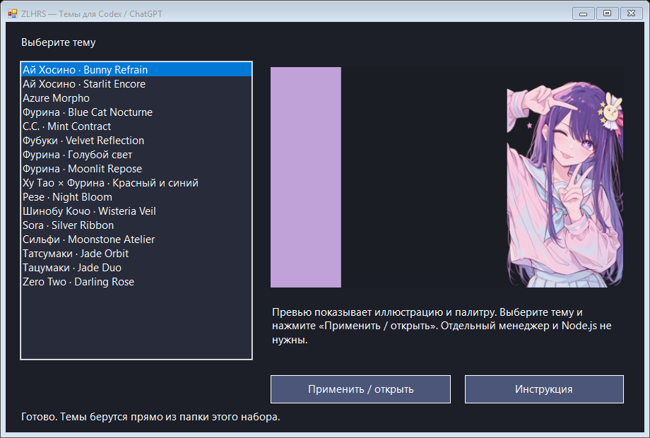

# Установка и выбор тем — версия 1.5.0

1. Скачайте [готовый ZIP](../codex-anime-themes.zip) или клонируйте репозиторий. Распакуйте архив целиком.
2. Откройте **ZLHRS Theme Studio.cmd** двойным щелчком. Комплект установится автоматически, появятся ярлыки ChatGPT и ZLHRS Theme Studio.
3. Выберите тему в списке с превью и нажмите **«Применить тему»**.

В комплекте есть собственное окно выбора, все 16 тем и механизм их применения. **Node.js и Codex App Manager не нужны.** Нужны Windows 10/11 и уже установленный настольный Codex / ChatGPT с пакетом `OpenAI.Codex`; само приложение OpenAI не распространяется в этом репозитории.

## Автоматическое включение последней темы

Первый запуск **ZLHRS Theme Studio.cmd** автоматически настраивает всё необходимое. Программа и темы установятся в %LOCALAPPDATA%\ZLHRS\ThemeStudio. На рабочем столе и в меню Пуск появятся **ChatGPT** (сразу запускает последнюю тему) и **ZLHRS Theme Studio** (каталог тем).

Если ChatGPT закреплён на панели задач старым значком, открепите его и закрепите новый ярлык. Прямой запуск EXE или из Microsoft Store не перехватывается. Для обновления установленной копии снова откройте ZLHRS Theme Studio.cmd в свежем комплекте; выбранная тема сохраняется.

## Первый запуск и переключение

Если приложение уже открыто обычным ярлыком, полностью закройте его и нажмите кнопку в меню снова. Меню не завершает ваши процессы принудительно. После запуска через меню темы переключаются в открытом приложении без перезапуска, обычно за несколько секунд. Окно выбора можно закрыть.

Выбор хранится в `.selected-theme.json` рядом с меню; изображения используются прямо из `themes`. Не нужно вручную копировать папки или менять настройки другого менеджера. Папку набора не перемещайте во время работы приложения.

## Если установлен Codex App Manager

Это [сторонний open-source проект Wangnov под MIT](https://github.com/Wangnov/Codex-App-Manager), а не личная программа автора набора. Он устанавливается отдельно и не нужен новому меню. Закройте его перед применением темы, иначе два механизма могут возвращать разное оформление. Набор использует его MIT-компоненты оформления; лицензия сохранена в `launcher/LICENSE`.

## Обновление

При клонировании: выполните `git pull` в папке набора. При скачивании: загрузите свежий ZIP и распакуйте в отдельную папку. Не смешивайте файлы старого и нового выпусков. Старые `Install-Themes.ps1`, `Select-Theme.ps1` и Node.js-запуск оставлены для совместимости; основной способ теперь **START.cmd**.

## Если не работает

- Сообщение меню объясняет, что мешает запуску: открытый менеджер, уже запущенное обычным способом приложение или отсутствующая установка.
- Поддерживается Windows-пакет `OpenAI.Codex` с `app/ChatGPT.exe`; другие варианты установки пока не поддержаны.
- Для диагностики есть `.theme-error.log` рядом с меню. Это локальный файл, он не входит в Git.
- После обновления приложения может потребоваться адаптация CSS. Механизм проверен локально на Windows; на другом компьютере набор ещё не испытывался.
- Для обычного оформления полностью закройте приложение и откройте обычным ярлыком.

## Как работает комплект

Использует встроенный Windows PowerShell и локальное подключение `127.0.0.1:9345` для добавления CSS. Не публикуйте этот порт в сеть. Установка системных компонентов, администраторские права, ключи API и загрузки при старте не нужны. `ExecutionPolicy Bypass` в START.cmd действует только на запущенный процесс, системную политику не меняет.
